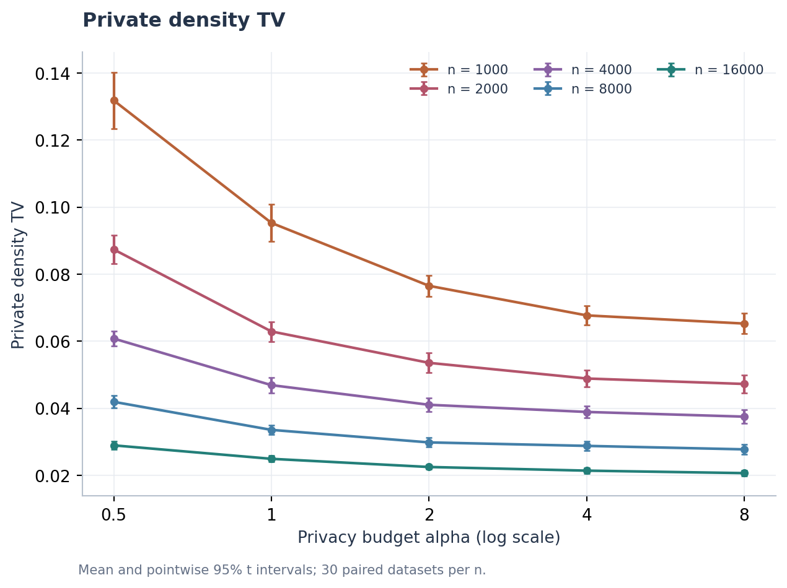
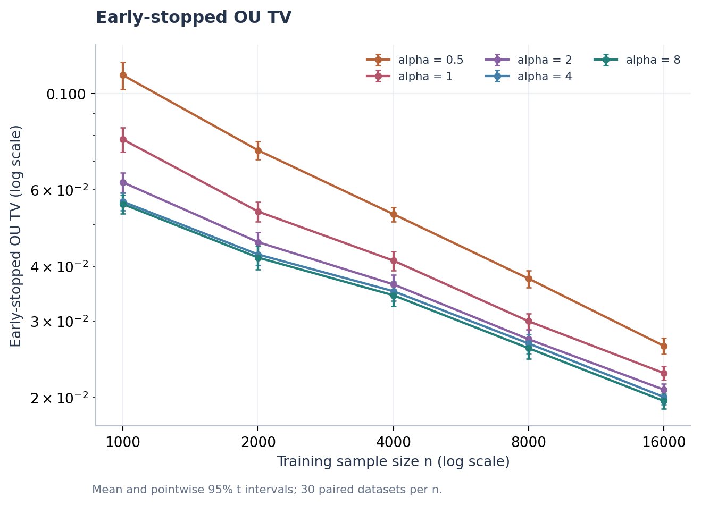
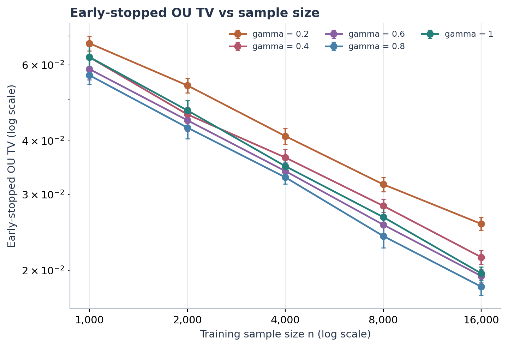
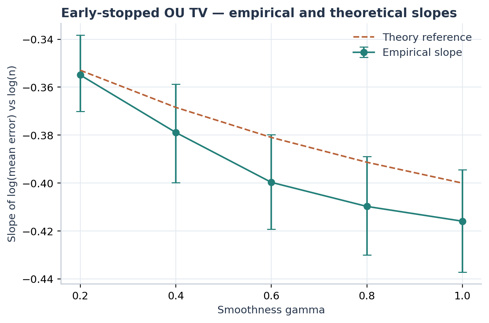

# Diffusion extension simulations

This repository snapshot contains two connected paper panels and one
mechanism-level diagnostic:

1. **Privacy-budget panel:** vary total privacy budget `alpha` at fixed
   smoothness `gamma=0.5`.
2. **Smoothness panel:** vary `gamma` at fixed privacy budget `alpha=2`.
3. **Private/non-private stability pilot:** replace one training record and
   measure the resulting coefficient and output-function shifts.

Every experiment fixes the multiscale target settings at `K=40` and amplitude
`0.25`. The private score parameter sampler is **projected LMC**; Gibbs is not
used. Clean-score risk is not reported or plotted.

## Alpha panel: privacy sensitivity

- `n in {1000, 2000, 4000, 8000, 16000}`
- `alpha in {0.5, 1, 2, 4, 8}`
- 30 independent datasets per sample size; the same dataset is reused across
  privacy budgets within a repetition
- independent projected-LMC, histogram, reverse-diffusion, and OU-reference
  randomness for each privacy budget
- fixed `gamma=0.5`, `K=40`, and amplitude `0.25`

The output contains 750 density observations, 750 revised generated-sample
observations, and 210 discretization runs. The reverse sampler uses the
exponential integrator, the Lemma 1.7 grid, and validated 3,201-point OU-score
interpolation. Its main TV rate reference is `-3/8` after omitting logarithmic
factors. The empirical OU-TV slopes approach that value at the larger privacy
budgets; the fixed-target finite-sample slopes should not be described as a
proof of a minimax equality.

## Gamma panel: smoothness sensitivity

- `n in {1000, 2000, 4000, 8000, 16000}`
- `gamma in {0.2, 0.4, 0.6, 0.8, 1.0}`
- 30 independent datasets per `(n, gamma)`; changing gamma changes the target
  distribution, so datasets are independent across gamma
- fixed `alpha=2`, `K=40`, and amplitude `0.25`

The 750-run panel compares the empirical sample-size slope with
`-(gamma+1)/(2 gamma+3)`. Early-stopped OU TV follows this reference most
closely. Generated binned TV becomes flatter when the roughly `0.013`
finite-particle/binning floor is material. The `alpha=2, gamma=0.5` result from
the alpha panel is used only as a bridge marker and is excluded from the gamma
slope fit.

## Stability diagnostic

The 450-row pilot fixes `gamma=0.5` and compares private and non-private output
changes after typical and stress one-record replacements. Coefficient metrics
and output-function metrics are presented in separate figures. Differential
privacy is a distributional guarantee, so these coupled shifts are diagnostic
evidence rather than a privacy theorem.

The recommended paper order and precise interpretation are in
[`PAPER_GUIDE.md`](PAPER_GUIDE.md). Reproduction commands are in
[`REPRODUCIBILITY.md`](REPRODUCIBILITY.md).
